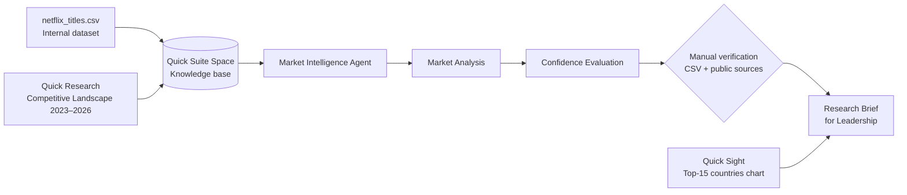

# Streaming Content Investment Strategy: AI-Assisted Market Intelligence

**Udacity Nanodegree: Future AWS Agentic AI Business Professional, Project Submission**
**Tools:** Amazon Quick Suite (Spaces, Quick Research, a custom Chat Agent, Quick Sight)

---

## Overview

This project uses Amazon Quick Suite's Agentic AI tools to answer one business question:

> **How should a streaming platform prioritize content investment (by genre, format and region) to compete over the next 12–24 months, given the current competitive landscape, subscriber-growth trends and consolidation in the global SVoD market?**

It combines an **internal dataset** (a Netflix catalog snapshot of 8,807 titles) with **external research** covering 2023–2026. A custom **Market Intelligence Agent** pulls the two together into a market analysis, a confidence evaluation and a final research brief for leadership. Key figures were then checked by hand against the CSV and public sources. That check caught and fixed one factual error in the agent's draft.

## Workflow

1. **Baseline from the dataset.** Uploaded `netflix_titles.csv` and a reference note to a Quick Suite Space to profile the catalog by format, country, genre and rating.
2. **External research.** Ran one tightly scoped Quick Research job on seven scaled competitors (Netflix, Amazon Prime Video, Disney+, HBO Max, Paramount+, Apple TV+, Peacock) and four themes: ad tiers, password sharing, live sports and international content.
3. **Agent synthesis.** Built a custom chat agent with the Space as its knowledge base. It produced a Market Analysis in which every claim is labeled `[Dataset]` or `[External]`.
4. **Confidence evaluation.** The agent rated each insight on source quality, consistency, timeliness, gaps, signal freshness and "what would change our mind." Insights backed only by the dataset could not be rated High.
5. **Human verification.** Spot-checked key figures against the CSV and primary sources, and corrected the agent's mis-dated Paramount–WBD deal timeline.
6. **Visualization.** Built a Quick Sight bar chart comparing movies and TV shows for the top 15 producing countries.

## Limitations

- **Stale, single-platform dataset.** The catalog ends ~Sept 2021 and has no viewership, subscriber or revenue data.
- **Different metrics.** Catalog stock (2021) and new-commission flow (2024–25) measure different things.
- **Source bias.** External sources are English-language only, and market-size projections (Statista, Mordor) vary with how the market is defined.
- **AI synthesis risk.** The agent can state uncertain figures confidently. Its first draft mis-dated the WBD deal, which manual verification caught. The Market Analysis and the Confidence Evaluation are the agent's earlier outputs. The Research Brief holds the final, verified figures and ratings.

## Files

| File | Description |
|------|-------------|
| Netflix Titles Dataset | Netflix catalog from Kaggle (through ~2021) |
| Competitive Landscape 2023–2026 | External research (Quick Research) |
| Market Analysis | Agent's market analysis |
| Reliability & Confidence Evaluation | Agent's confidence assessment |
| Market Intelligence Research Brief | **Final brief: start here** |

## Data Source

**Netflix Movies and TV Shows** by Shivam Bansal, Kaggle: <https://www.kaggle.com/datasets/shivamb/netflix-shows>
Fields: `show_id, type, title, director, cast, country, date_added, release_year, rating, duration, listed_in, description`. Used unmodified.

Completed as part of the Udacity Future AWS Agentic AI Business Professional Nanodegree. This is an educational project, not investment or business advice.
